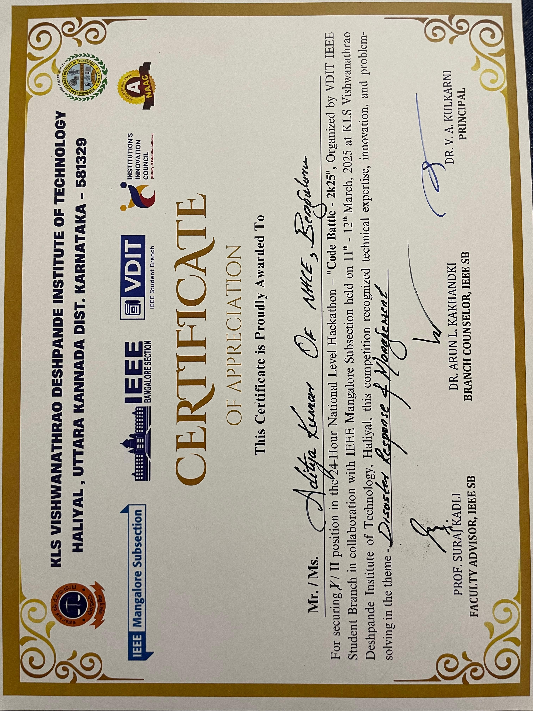
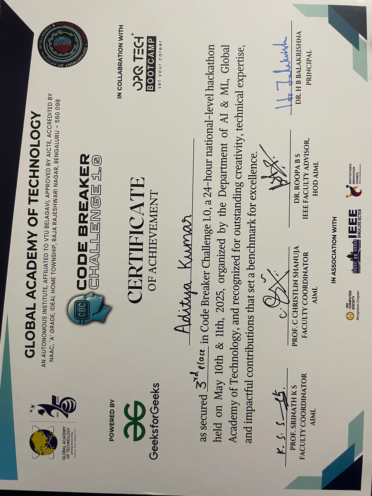
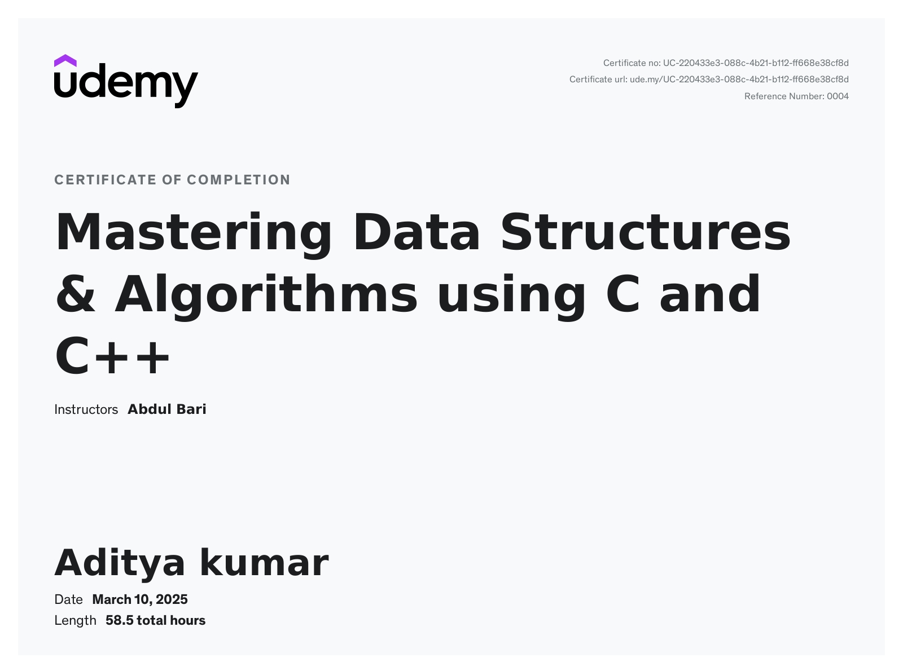
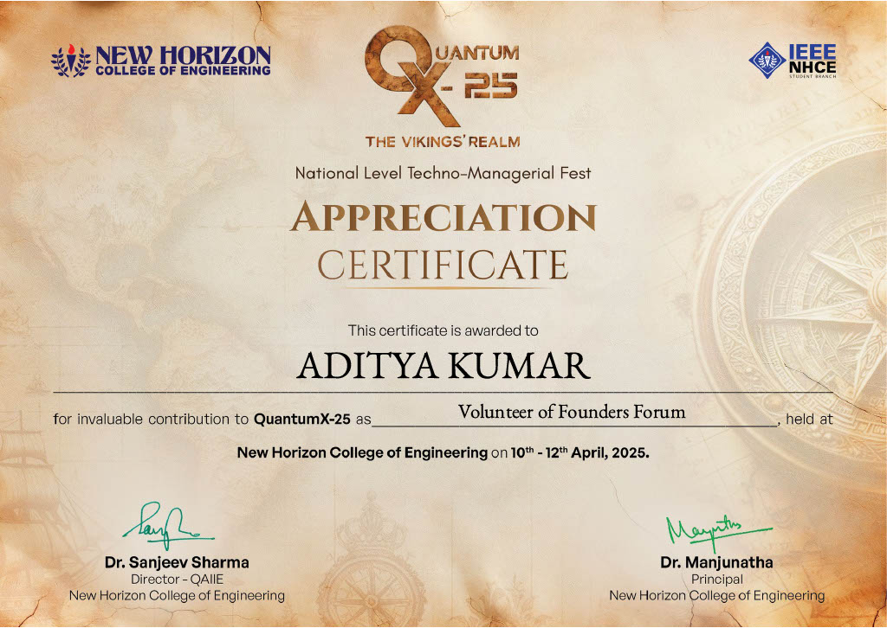
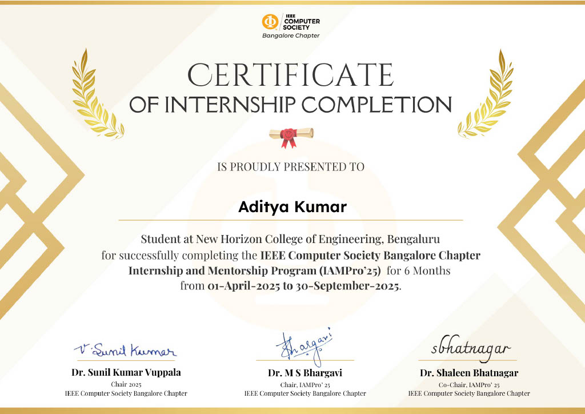

  

  

  
  
  
  
  
   
  
  

  
  

  📫 <b>adityakumarnhce@gmail.com</b> &nbsp;|&nbsp; 🌐 <a href="https://adityakrportfolio.vercel.app/">Portfolio</a> &nbsp;|&nbsp; 📍 Bengaluru, India

---

## 👋 About Me

I'm a Software Engineering student (B.E. Computer Science – Data Science, CGPA 9.22) with a strong backend and data-first mindset. I design scalable APIs, work across Python/SQL for data cleaning and analysis, and enjoy applying core CS fundamentals to build reliable, data-driven systems. I've shipped full-stack AI/ML products end-to-end and recently interned building a full-scale Electronics PLM system.

- 🔭 **Currently building:** [InfraMind](https://github.com/Adityarish) — an AI-powered IT infrastructure management platform (n8n + Neo4j + FastAPI + ServiceNow)
- 🌱 **Currently exploring:** Agentic AI, PowerBi and System Design
- 👯 **Open to collaborating on:** AI-powered backend systems & real-time applications
- ⚡ **Fun fact:** I count sheep to fall asleep — and then square them.

---

## 💼 Experience

**Software Developer Intern** · forUdyog, Kolkata, India · *Feb 2026 – May 2026*
Built a full-stack Electronics PLM system in React with database integration — covering Projects, Versions, BOM, inventory, supplier/quotation management, and production workflows.

---

## 🚀 Featured Projects

<table>
<tr>
<td width="50%" valign="top">

<h3>🏋️ LockedIn — AI Fitness Platform</h3>

AI-powered fitness platform providing real-time posture correction, automatic repetition counting, and exercise tracking. Uses MediaPipe and OpenCV for body landmark detection, powered by a microservices architecture integrating React, Node.js, and Python.

<code>Python</code> <code>OpenCV</code> <code>MediaPipe</code> <code>React</code> <code>Node.js</code>

<a href="https://github.com/ImAust1n/Locked.in.git">🔗 Repository</a>

</td>
<td width="50%" valign="top">

<h3>🗺️ JobAtlas — Smart Job Discovery Platform</h3>

Full-stack job discovery platform that crawls Indian company career pages using Crawl4AI and Python. Features structured job extraction, interactive India map visualization, and advanced filters for location, domain, experience, fresher eligibility, and salary.

<code>Next.js</code> <code>Node.js</code> <code>MongoDB</code> <code>Python</code> <code>Crawl4AI</code> <code>Express.js</code>

<a href="https://github.com/Adityarish/CrawlAgent">🔗 Repository</a> |
<a href="https://crawl-agent-2aye.vercel.app/">🚀 Live Demo</a>

</td>
</tr>

<tr>
<td width="50%" valign="top">

<h3>🎙️ Yappy — Offline Speech-to-Text</h3>

Privacy-focused, low-latency speech recognition system powered by faster-whisper. Processes 16kHz audio locally using an optimized transcription pipeline, with Chrome Extension integration to inject transcribed speech directly into website input fields.

<code>Python</code> <code>FastAPI</code> <code>Whisper</code> <code>CTranslate2</code> <code>Chrome Extension</code>

<a href="https://github.com/Adityarish/YapYap">🔗 Repository</a>

</td>
<td width="50%" valign="top">

<h3>📸 TripNest — Cloud Trip Media Organizer</h3>

Private cloud-based platform for organizing trip photos, videos, and documents while preserving original quality. Integrates Google Drive for storage, Clerk for authentication, resumable uploads, personal trip folders, and an installable PWA with Chrome Extension support.

<code>Next.js</code> <code>TypeScript</code> <code>Google Drive API</code> <code>Clerk</code> <code>PostgreSQL</code> <code>Prisma</code>

<a href="https://github.com/Adityarish/TripNest">🔗 Repository</a>

</td>
</tr>

<tr>
<td width="50%" valign="top">

<h3>📂 UseMe — Secure File & Text Sharing</h3>

Secure file and text-sharing platform with customizable URLs, anonymous uploads, and optional authentication. Supports password-protected content, one-time viewing, configurable expiration, Google Drive storage, and owner-controlled file management.

<code>Next.js</code> <code>TypeScript</code> <code>Supabase</code> <code>PostgreSQL</code> <code>Google Drive API</code> <code>Drizzle ORM</code>

<a href="https://github.com/Adityarish/UseMe">🔗 Repository</a> |
<a href="https://useme-delta.vercel.app/">🚀 Live Demo</a>

</td>
<td width="50%" valign="top">

<h3>🧠 RAG — Document Intelligence System</h3>

Retrieval-Augmented Generation system enabling intelligent question-answering over custom documents. Implements document chunking, 384-dimensional semantic embeddings, FAISS vector similarity search, and context-grounded LLM responses for accurate knowledge retrieval.

<code>Python</code> <code>Flask</code> <code>FAISS</code> <code>NLP</code> <code>Embeddings</code> <code>LLM</code>

<a href="https://github.com/Adityarish/RAG">🔗 Repository</a>

</td>
</tr>
</table>

---

## 🛠️ Tech Stack

<h4>Languages</h4>

  
  
  
  
  

<h4>Frontend</h4>

  
  
  
  
  

<h4>Backend & Automation</h4>

  
  
  
  

<h4>Databases</h4>

  
  
  

<h4>Data Analysis & ML</h4>

  
  
  
  

<h4>Tools</h4>

  
  
  

---

## 🏆 Achievements

<h3>🥇 Hackathon Wins</h3>

  

    <!-- Replace src below with your own image path once uploaded, e.g. ./assets/achievements/code-battle.png -->
    
    
  

  

    🥈 <b>2nd Prize — Code Battle 2k25</b> (National Hackathon, VDRIT × IEEE, March 2025) 
    🥉 <b>3rd Prize — Code Breaker Challenge 2.0</b> (National Hackathon, GAT Bengaluru, May 2025)
  

<h3>📜 Certifications</h3>

  

    <!-- Replace src below with your own certificate image once uploaded -->
    
    
    
  

  

    <b>The Complete Python Pro Bootcamp</b> — Udemy 
    <b>Mastering Data Structures and Algorithms using C/C++</b> — Udemy
    <b>The Complete Full Stack Web Developer Bootcamp</b> - Udemy
  

<h3>🗂 More Certificates & Diplomas</h3>

   

    
    
  

  

    <b>Appreciation Certificate — QuantumX-25</b> Apr 2025 
    <b>Certificate of Internship Completion</b> — IAMPro'25 (6-month program, Apr–Sep 2025)
  

---

## 📊 GitHub Stats

  

